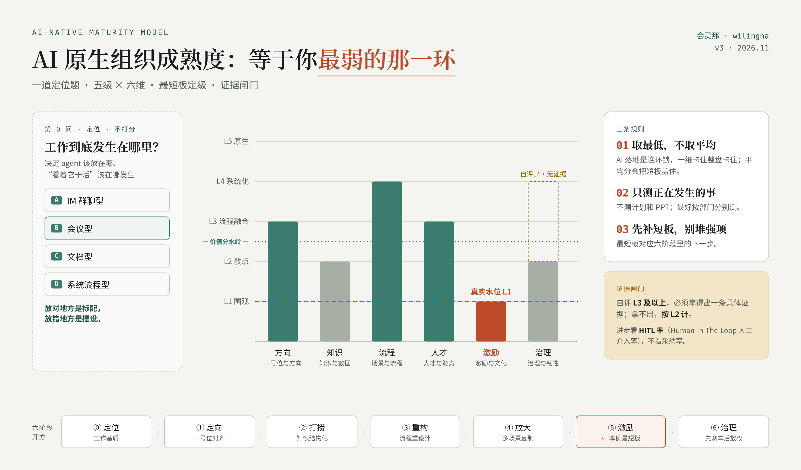

<div align="center">

# 🪜 AI-Native Maturity · v3

### Your organization's AI maturity equals your weakest link.
### 一个组织的 AI 成熟度，等于它最弱的那一环。

**Not another strategy deck — a 3-minute self-diagnostic that names the one thing holding your AI transformation hostage.**
**不是又一份转型 PPT——三分钟自测，点出那个卡住你整盘 AI 的"最短板"。**

[](https://opensource.org/licenses/MIT)
[](https://wilingna.github.io/ai-native-maturity/)
[](CHANGELOG.md)
[](https://github.com/wilingna/ai-native-maturity)
[](https://github.com/wilingna/ai-native-maturity)

[**🔗 Try it now**](https://wilingna.github.io/ai-native-maturity/) · [English](#-english) · [中文](#-中文) · [The Model](#-the-model--模型) · [What's new in v3](CHANGELOG.md)

</div>

<p align="center"></p>

---

## 🎯 TL;DR

**EN** — Most AI-maturity models hand you an *average* score that conveniently hides your real problem. This one scores you by your **lowest** dimension — because AI adoption is a chain: if incentives sit at L1, it doesn't matter that your workflows hit L4, the whole thing stalls. One unscored positioning question, six dimensions, five levels, an evidence gate against self-flattery, one honest number. Shipped as a runnable self-test, not a PDF.

**中文** — 大多数成熟度模型给你一个"平均分"，刚好把你真正的问题盖住。这套按你**最低**的那一维定级——因为 AI 落地是连环锁：激励还在 L1，流程冲到 L4 也没用，整盘照样卡。一道不打分的定位题、六维、五级、一道防自评虚高的证据闸门、一个诚实的数字。做成能跑的自测，不是一份 PDF。

```
第0问 工作基质 ─┐
                ▼
L1 围观 → L2 散点 → ⟍ 价值分水岭 ⟍ → L3 流程融合 → L4 系统化 → L5 原生
        （还在试）                      （AI 开始在组织里干真活）
```

> **Skills aren't the asset. Cases are.**
> **Skill 不是资产，Cases 才是。**

---

<a name="-english"></a>
## 🌍 English

### The Problem
Every consultancy has an "AI maturity model." They average six nice-looking scores into one number that makes leadership feel fine — and buries the one dimension that's actually killing the rollout. Averages lie. Chains don't.

The 2026 data agrees: AI is now in almost every company, yet only a small minority see real earnings impact. The gap is organizational, not technical.

### How it scores
1. **Question Zero (not scored)** — where does work actually happen?
2. Pick your level (L1–L5) on six dimensions.
3. **Evidence gate** — claim L3 or above and you must tick a concrete proof. No proof → scored as L2.
4. Your real maturity = the **minimum**, not the mean. The tool names your weakest link, flags imbalance, and maps you to the next stage of the playbook.

### Question Zero (not scored): where does work actually happen?
Is your organization's **work substrate** IM, meetings, documents, or systems? Nearly every mainstream AI-adoption playbook silently assumes work happens in group chat — true in Silicon Valley, false in most large Chinese organizations. The substrate decides where an agent belongs and where "watching it work" should happen. Right agent, wrong place = shelfware. → [`docs/work-substrate.md`](docs/work-substrate.md)

### The six dimensions
1. **Leadership & Direction** — does the boss actually use it, can they say in one line what AI is *for*, and is investment concentrated on 3–4 workflows and tracked in the P&L?
2. **Knowledge & Data** — is core know-how trapped in people's heads, or structured so *agents* can reach it — with human corrections flowing back in?
3. **Workflow & Scenarios** — was the workflow *redesigned* around AI (outcome first, then human/agent split), or was AI bolted onto the old one? Honest metric: **HITL (Human-In-The-Loop) rate** — the share of agent output a human must check, edit or override — not adoption rate.
4. **Talent & Capability** — one or two heroes, or frontline staff? Are people *asking questions* or *writing specs*? Is workforce planning done for humans *and* agents — while keeping a path for juniors to become experts?
5. **Incentives & Culture** — "digging my own grave" or "in my interest"? Is reinvention rewarded even when early results are uneven? Where does the saved time go — capability, or just more work?
6. **Governance & Resilience** — controls before autonomy: owner, observability, approval/rollback gates, audit log, cost guardrails. Plus the lethal-trifecta check and three stress tests: survive a **model swap**, a **vendor exit**, a **single-node failure**?

### Use it
- **Self-test** → [live demo](https://wilingna.github.io/ai-native-maturity/) (run it per team, not just once for the whole company)
- **Go deeper** → [the 6-stage playbook](docs/methodology.md) (the model says *where you are*; the playbook says *where to go next*)
- **Track progress** → [four honest metrics + event-log template](docs/honest-metrics.md)
- **Want help landing it?** → [reach out](#-about--关于)

---

<a name="-中文"></a>
## 🇨🇳 中文

### 问题
人人都有一套"AI 成熟度模型"，把六个好看的分一平均，凑出一个让领导安心的数字——顺手埋掉那个真正在拖垮落地的维度。平均分会撒谎，连环锁不会。

2026 年的数据也在说同一件事：AI 几乎进了每家公司，但真正赚到钱的只有少数——差距在组织，不在技术。

### 怎么定级
1. **第 0 问（不打分）**：你的工作到底发生在哪里？
2. 六个维度各选 L1–L5。
3. **证据闸门**：自评 L3 及以上，必须勾选一条具体证据；拿不出证据，按 L2 计。
4. 真实水位取**最低**那一维，不取平均。工具会点出最短板、提示"偏科"，并对应到六阶段的下一步。

### 第 0 问（不打分）：你的组织，工作到底发生在哪里？
你的**工作基质**是 IM、会议、文档，还是系统？
几乎所有主流 AI 落地方法论都默认"工作发生在群聊里"——这在硅谷成立，在大量中国大型组织里不成立。基质决定 agent 该嵌在哪、"让人看着它干活"该在哪个场合发生。**放对地方是标配，放错地方是摆设。**
→ [`docs/work-substrate.md`](docs/work-substrate.md)

### 六个维度
一号位与方向 · 知识与数据 · 场景与流程 · 人才与能力 · 激励与文化 · 治理与韧性
（每一维都附"一眼判断口诀"和"证据闸门"，见自测工具。）

**v3 的关键判据：**
- **方向**：资源是收拢到 3–4 条核心流程，还是撒胡椒面？AI 价值进没进 P&L？
- **流程**：是重新设计了流程，还是把 AI 贴在旧流程上？**HITL 率（Human-In-The-Loop，人工介入率）比采纳率诚实。**
- **人才**：员工在"提问"还是在"写 spec"？编制规划算没算上 agent？新人还有没有成为专家的路？
- **激励**：早期结果不稳的尝试被不被奖励？**省下的时间去了哪**——能力，还是加活？
- **治理**：**先装刹车，再给自主权**——每个 agent 有没有 owner、日志、回滚、成本护栏？致命三要素查了没有？三项韧性测试过不过？

### 怎么用
- **自测** → [在线 Demo](https://wilingna.github.io/ai-native-maturity/)（建议按部门/团队分别测）
- **往下走** → [六阶段方法论](docs/methodology.md)（模型回答"我在哪"，方法论回答"往哪走"）
- **看进步** → [四个诚实指标 + 流程事件日志模板](docs/honest-metrics.md)
- **想落地** → [找我聊聊](#-about--关于)

---

<a name="-the-model--模型"></a>
## 🧩 The Model / 模型

| 文件 | 是什么 |
|---|---|
| `index.html` | 诊断器（开源 · 数据只在浏览器里） |
| `docs/work-substrate.md` | 第 0 问：工作基质 |
| `docs/methodology.md` | 六阶段落地方法论（含治理六件控制、致命三要素、三项韧性测试） |
| `docs/honest-metrics.md` | 四个诚实指标 + 只追加日志模板 |
| `docs/evidence-2026.md` | 附录：设计依据与出处（可选读） |
| `cases/` | 真实落地案例——**这一层才是护城河** |
| `CHANGELOG.md` | 版本记录 |

---

<a name="-about--关于"></a>
## 🙋 About / 关于
**会灵那 / wilingna** — 20 年 HR 与组织设计，现在专做 AI 在企业里的真落地。
[小红书 / B站 / 视频号：会灵那]

## License
Tool & code: MIT. Methodology docs: CC BY 4.0.
